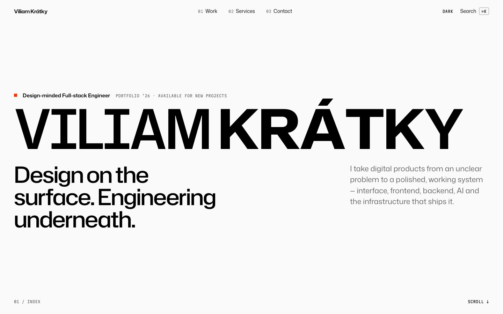

# Viliam Krátky · Portfolio

The source of my personal portfolio: a static site with a motion layer on top, built to show how I work from interface to infrastructure.



## What's interesting here

- **Kinetic typography.** Headlines are set in Hubot Sans, a variable font with weight and width axes. Each letter reacts to the cursor; when the cursor rests, a slow wave runs through the word. Plain `requestAnimationFrame` and `font-variation-settings`, no canvas. See [`src/interactive/motion.ts`](src/interactive/motion.ts).
- **Scroll scenes.** A pinned scrollytelling scene where a halftone field turns the page from white to black, a work list with a cursor-following preview that resolves from an ordered dither into the real image, and a terminal that types real output. GSAP ScrollTrigger and Lenis.
- **Keyboard layer.** `⌘K` command menu (cmdk) with a small command line (`:whoami`, `:stack`, `:system`, `:open <project>`), `j` / `k` section navigation, `g` + letter page jumps and `?` for help. Single-key shortcuts never fire inside inputs and can be switched off. See [`src/interactive/keys.ts`](src/interactive/keys.ts).
- **Static first.** Every page is static HTML from Astro and works without JavaScript. React runs in exactly one island, the command menu. Under `prefers-reduced-motion` every scene renders in its final state.
- **Real data only.** Status, location, build date and commit come from config and the build, never from decoration.
- **Light and dark** themes, shared element transitions between the work list and case studies (cross-document View Transitions), and a build that fails if a project has no publication clearance.

## Stack

Astro 7 · TypeScript · Tailwind CSS v4 (design tokens via `@theme`) · GSAP + Lenis · React + cmdk (command menu only) · MDX content collections · Fontsource (Hubot Sans, Mona Sans, Martian Mono, Doto).

## Run it

```bash
npm install
npm run dev        # http://localhost:4321
npm run check      # types
npm run build      # static output in dist/
npm run preview
```

## Structure

| Path | What |
| --- | --- |
| `src/config/site.ts` | Identity, links, location, availability, route manifest |
| `src/styles/global.css` | Design tokens, type scale, prose |
| `src/content/work/*.mdx` | Projects and case studies; schema in `src/content.config.ts` |
| `src/interactive/` | Motion layer, keyboard manager, command menu |
| `src/components/` | Shell, home scenes, work components |
| `docs/` | How the site was planned and built |

## How it was built

The site was built with coding agents working against written specifications. Before any code there was a positioning document, a design system, an interaction model and an information architecture; the visual direction was later replaced after a prototype round. The reasoning is kept in [`docs/`](docs/), with decisions and their rationale in [`docs/BUILD_LOG.md`](docs/BUILD_LOG.md).

## License

Code is MIT. Written content, case studies, images and the resume are all rights reserved. See [LICENSE](LICENSE).
